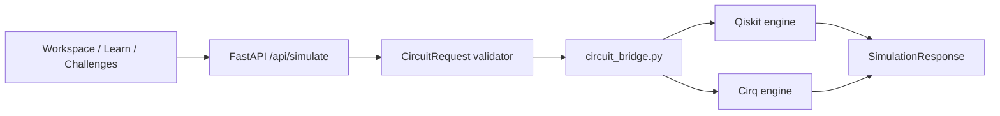

# Cirq integration, engine robustness & gamification plan

**Document ID:** QW-PLAN-CIRQ-ENG-002  
**Status:** draft architecture & product plan  
**Date:** 19 October 2026  
**Related:** [SIRRAYA_REFERENCE_AND_ROADMAP.md](SIRRAYA_REFERENCE_AND_ROADMAP.md), [PLATFORM_BUILD_PLAN.md](PLATFORM_BUILD_PLAN.md), `api/simulator.py`, `web/lib/milestones.ts`

---

## 1. Executive summary

| Goal | Recommendation |
| --- | --- |
| Add **Cirq** | Keep **one canonical circuit JSON** (`CircuitRequest`); add a **bridge layer** and ship **export first**, then optional **Cirq simulation backend** for validation and future Google-style workflows. |
| **Robust** quantum system | Dual-engine parity tests, strict bounds, circuit revision IDs, labeled simulation modes, eventual async jobs for heavy runs. |
| **Gamification** | Extend progress from binary milestones to **XP, streaks, skill nodes, and challenge tiers** — always graded by the **simulator**, never by the UI alone. |
| **Animation** | Tie motion to **real step/state changes** (Bloch, probabilities, unlocks); reuse global ambience; respect `prefers-reduced-motion`. |

---

## 2. Current baseline (QuantumWalk)

```
Browser (Next.js)  →  POST /api/simulate  →  simulator.py (Qiskit Statevector + Aer shots)
                      POST /api/export/qiskit
Progress            →  lesson/challenge slugs, score 0|100, milestones list
/start              →  local "✦ N/4 explored" (not persisted)
```

- **Gate set:** `h,x,y,z,s,t,rx,ry,rz,cx,cz,swap,measure` — maps cleanly to both Qiskit and Cirq for education-scale circuits.  
- **Limits:** ≤5 qubits, ≤64 ops, ≤4096 shots (enforced in Pydantic).  
- **Gamification:** Four static milestones; challenges pass/fail via simulator comparison.

---

## 3. How Cirq fits (architecture)

### 3.1 Principle: canonical model, pluggable engines

Do **not** let the frontend speak Cirq or Qiskit directly. All edits stay in `CircuitRequest`; engines are server-side adapters.



### 3.2 Integration phases

| Phase | Scope | Risk | User value |
| --- | --- | --- | --- |
| **C0 — Export** | `POST /api/export/cirq` mirroring `export/qiskit` | Low | Learners copy code into Colab / Cirq tutorials |
| **C1 — Opt-in backend** | `engine: "qiskit" \| "cirq"` on simulate (default `qiskit`) | Medium | “Same circuit, two libraries” teaching moment |
| **C2 — Parity suite** | CI runs paired simulations; max amplitude delta ε | Medium | Engineering robustness |
| **C3 — Cirq-native extras** | Noise channels via `cirq.DensityMatrixSimulator` (bounded) | Medium | Pedagogical noise without claiming hardware |
| **C4 — Import (optional)** | Restricted Cirq JSON or OpenQASM 2 subset | High | Defer until export + dual-run stable |

### 3.3 Bridge design (`api/circuit_bridge.py`)

**Responsibilities:**

1. Map each `Operation` → Qiskit instruction (existing logic moves here from `simulate()`).  
2. Map each `Operation` → `cirq.Gate` on `cirq.LineQubit(i)`.  
3. Document **line order**: keep “qubit 0 = rightmost bit in basis labels” in API responses; Cirq lines are indexed 0..n-1 left-to-right in export comments.  
4. Reject unknown gates at validation (already done).

**Example export shape (illustrative):**

```python
import cirq

qubits = cirq.LineQubit.range(2)
circuit = cirq.Circuit(
    cirq.H(qubits[0]),
    cirq.CNOT(qubits[0], qubits[1]),
)
```

**Rotation gates:** `cirq.rx(rads)`, `cirq.ry`, `cirq.rz` with same radian bounds as API.

**Measurement:** For step snapshots, Cirq engine should use **statevector simulation without measurement ops** in the step loop (match current Qiskit behavior); apply measurement only for `counts` at the end.

### 3.4 Dependencies & ops

Add to `api/requirements.txt` (pin after spike):

```
cirq-core==1.x  # pin exact version after compatibility test with Python runtime
```

- Keep Aer as **default** (already integrated, fast for small circuits).  
- Cirq simulator runs in same **simulation_slot** and **rate limits** as Qiskit.  
- Never execute exported code on the server.

### 3.5 API contract changes (minimal)

```json
{
  "qubits": 2,
  "operations": [...],
  "shots": 1024,
  "engine": "qiskit"
}
```

Response extension (optional transparency):

```json
{
  "mode": "ideal_simulator",
  "engine": "qiskit",
  "basis_order": "..."
}
```

UI: settings toggle **Simulation engine** (Advanced) with tooltip: “Results should match; report discrepancies.”

### 3.6 When Cirq is worth it for QuantumWalk

| Use case | Qiskit-only | + Cirq |
| --- | --- | --- |
| MVP lab & lessons | ✓ | Optional |
| Export to industry examples | Qiskit export ✓ | Cirq export for Google-curriculum learners |
| Teaching “multiple SDKs” | Weak | Strong |
| Future Google Quantum hardware | Via Qiskit transpile | Native Cirq path later |
| Robustness | Single engine | Dual-engine cross-check |

---

## 4. Robust quantum platform (beyond Cirq)

| Layer | Enhancement | Notes |
| --- | --- | --- |
| **Validation** | Keep `extra="forbid"` on all circuit DTOs | Already in `simulator.py` |
| **Identity** | `circuit_revision_id` + `result_id` on simulate responses | Prevents mixed panels after edits |
| **Engines** | Dual-run in CI for golden circuits (Bell, Grover step, etc.) | Fail build if \|Δp\| > 1e-5 |
| **Noise** | Separate `mode`: `ideal_simulator` vs `pedagogical_noise` | Never label noise runs as hardware |
| **Scale** | Job queue when simulate p95 > timeout | Out of MVP until measured |
| **Hardware** | Provider adapter behind feature flag | `/hardware` stays honest |
| **Security** | Same CSRF + auth + quotas on `/export/cirq` | No arbitrary code execution |

---

## 5. Gamification — from milestones to engagement loop

### 5.1 Design rules (product)

1. **Simulator is the judge** — XP and passes come from API grading (like `submit_challenge` today).  
2. **Private by default** — no public leaderboards unless opt-in and moderated.  
3. **Novice first** — show progress as story (“Entanglement path 2/5”), not RPG jargon on first visit.  
4. **Anti-grind** — diminishing returns on repeating the same challenge; cap daily XP.

### 5.2 Proposed progression model

| Concept | Implementation sketch |
| --- | --- |
| **XP** | `progress.score` already 0–100; extend to cumulative XP table `user_stats(xp, level, streak_days)` |
| **Levels** | Thresholds e.g. 0–500 XP; unlock titles only (no paywall) |
| **Skill tree** | Nodes = `{lesson, challenge, lab_preset}`; edges = prerequisites; store completion on `activity_slug` |
| **Streaks** | `last_activity_date` UTC; +bonus XP for 3/7-day streak |
| **Challenge tiers** | Bronze: correct circuit; Silver: ≤N gates; Gold: match reference step count |
| **Achievements** | Expand `milestones.ts` + DB-driven catalog; categories: Explore, Build, Prove, Connect |
| **Discovery** | Persist `/start` “4/4 explored” to progress API on sign-in |

### 5.3 Backend touchpoints

| Endpoint | Change |
| --- | --- |
| `POST /api/challenges/{slug}/submit` | Return `{ score, tier, xp_awarded, hints }` |
| `POST /api/lessons/{slug}/answer` | Partial XP for thoughtful wrong answers (optional, capped) |
| `GET /api/progress` | Include `xp`, `level`, `streak`, `skill_nodes[]` |
| `GET /api/achievements` | Server-side catalog (avoid stale client-only milestones) |

### 5.4 Frontend surfaces

| Surface | Gamification UI |
| --- | --- |
| `/dashboard` | XP bar, next skill node, streak chip |
| `/workspace` | “Mission mode” banner when opened from challenge deep link |
| `/achievements` | Earned animation + filter by category |
| `/start` | Sync ✦ counter to account after login |

---

## 6. Animation strategy (professional, not cartoon)

### 6.1 Rules (align with PLATFORM_BUILD_PLAN)

- Animation **follows** simulator step index — gate highlight, Bloch lerp, probability bar tween from **last API snapshot**.  
- **One** global background canvas (`QuantumSiteAmbience` / `QuantumFlowField`); lab route uses **quiet** profile.  
- **`prefers-reduced-motion`:** instant state updates, static badges, no unlock confetti.  
- **Gamification unlocks:** short CSS/SVG pulse on badge (300–600ms), optional sound off by default.

### 6.2 High-value motion hooks

| Event | Animation |
| --- | --- |
| Step forward/back | Selected gate glow; Bloch vector slerp; amplitude row highlight |
| Challenge pass | Metrics rail flash green; XP float-up (`+50 XP`) |
| New achievement | Modal or toast with badge SVG draw-in |
| Skill tree node unlock | Node border illuminates along `--qw-flow-phase` |
| Wrong circuit run | Shake on invalid control (accessibility: `role=alert` text, not motion-only) |

### 6.3 Avoid

- Extra full-page canvases per route (performance + visual noise).  
- Loot-box randomness.  
- Animations that imply quantum behavior **not** in the simulator output.

---

## 7. Implementation roadmap (ordered)

| Sprint | Deliverables | Depends on |
| --- | --- | --- |
| **S1** | `circuit_bridge.py`; `POST /api/export/cirq`; docs in DEVELOPMENT | — |
| **S2** | `engine` flag + Cirq statevector path; dual-engine pytest fixtures | S1 |
| **S3** | Dashboard XP bar; persist start discovery; expand achievements catalog | DB migration |
| **S4** | Challenge tiers + XP awards; workspace mission banner | S3 |
| **S5** | Step-synced Bloch/probability tweens; achievement unlock motion | UI polish |
| **S6** | Cirq density-matrix noise (bounded); label `pedagogical_noise` | S2 |

**Estimated effort:** S1–S2 ~1 week; S3–S5 ~2–3 weeks; S6 ~1 week (team of 1–2).

---

## 8. Acceptance criteria

| ID | Criterion |
| --- | --- |
| AC1 | Bell pair: Qiskit vs Cirq amplitudes agree within 1e-5 per basis |
| AC2 | Export Cirq runs in Google Colab with only `cirq` pip install |
| AC3 | Challenge grade unchanged when `engine=cirq` on supported gates |
| AC4 | XP cannot increase without authenticated API event |
| AC5 | Reduced-motion: no essential info in motion-only cues |
| AC6 | Simulate limits unchanged; Cirq path respects same slot + rate limits |

---

## 9. Decisions needed from you

1. **Default engine:** stay Qiskit-only default with Cirq as advanced toggle? (Recommended: yes.)  
2. **Cirq scope:** export-only for next release, or dual-engine in same release?  
3. **Gamification tone:** subtle “mastery” vs explicit “levels/XP” on dashboard?  
4. **Leaderboards:** omit for v1? (Recommended: omit — privacy-first.)

---

## 10. Quick reference — file map (when implementing)

| Area | Likely files |
| --- | --- |
| Bridge + Cirq sim | `api/circuit_bridge.py`, `api/simulator.py`, `api/tests/test_cirq_parity.py` |
| Export | `api/platform_routes.py` (mirror qiskit export) |
| API types | `web/lib/api.ts`, simulate client payload |
| Gamification | `api/models.py` (UserStats), `platform_routes.py`, `web/app/dashboard/page.tsx`, `web/lib/milestones.ts` |
| Animation | `web/app/workspace/page.tsx`, `web/components/QuantumSphere.tsx`, shared motion tokens in `app/qw-layout.css` |

---

*Update this document when engine or XP schema decisions are finalized.*
