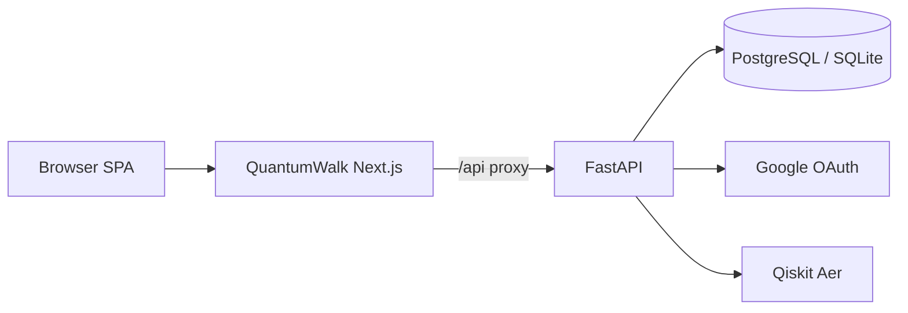

# Integration map

## External (OBSERVED on Sirraya, not required for QW)

| Integration | Sirraya | QuantumWalk |
| --- | --- | --- |
| Local TSP API | localhost:8000 | Same (compat route) |
| AI drafting | UNKNOWN endpoint | Optional OpenAI via coach |
| Google Fonts | Document export | Not used in QW academy |

## Sirraya tools.sirraya.org

Static CDN + client-only tools — **no** observed shared backend with QuantumWalk.
