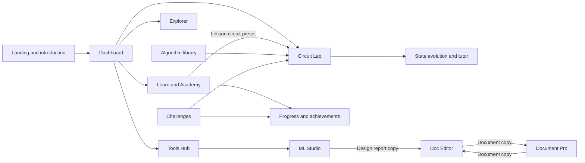

# QuantumWalk: platform overview and current feature inventory

**Product:** QuantumWalk  
**Tagline:** See inside a quantum algorithm.  
**Snapshot date:** 28 October 2026  
**Scope:** Features present in this repository and the current local application. This is a product and implementation inventory, not a claim of production deployment or certification.

## Contents

- [Product identity](#1-what-quantumwalk-is) and [platform structure](#3-product-structure).
- [Landing and introduction](#4-landing-and-introduction) and [dashboard](#5-dashboard).
- [Circuit Lab](#6-circuit-lab) and [Equation Whiteboard](#7-quantum-equation-whiteboard).
- [Learning and completion](#8-learning-system), [Foundations activities](#9-foundations-discovery-activities), and [specialist experiments](#10-specialist-academy-experiments).
- [Explorer](#11-explorer), [algorithm library](#12-algorithm-library), and [challenges and achievements](#13-challenges-progression-and-achievements).
- [Tools Hub](#14-tools-hub-and-document-workflow) and [coach/AI assistance](#15-coach-and-ai-assistance).
- [Accounts and saved work](#16-saved-work-identity-and-account-settings), [state persistence](#17-what-state-is-preserved-and-where), and [hardware/reference material](#18-hardware-and-reference-material).
- [UI and accessibility](#19-ui-interaction-and-accessibility-direction), [technical implementation](#20-technical-implementation), and [security/operations](#21-security-and-operational-boundaries).
- [Known limits](#22-known-limits-and-capabilities-not-present), [verification evidence](#23-current-verification-evidence), [example journeys](#24-example-end-to-end-journeys), and [source references](#25-source-references-and-related-documents).

## 1. What QuantumWalk is

QuantumWalk is an educational quantum-computing platform that connects guided lessons, interactive experiments, a visual circuit builder, and explanations of the underlying quantum state. Its central purpose is to help a learner understand what happens inside a small quantum algorithm, gate by gate.

The platform combines three kinds of experience:

1. **Learn:** Read a concept, try an experiment, and answer a comprehension question.
2. **Build and inspect:** Construct a circuit, execute it, and inspect its amplitudes, probabilities, local Bloch vectors, and intermediate states.
3. **Apply and compare:** Explore search and route problems, compare simulation engines, and complete simulator-graded challenges.

Supporting tools provide document editing, template preparation, a network-design exercise, account management, and progress tracking.

QuantumWalk currently runs quantum calculations on classical computers. The main backend uses Qiskit Aer and supports Cirq as an alternative engine. Some specialist experiments use local mathematical models in the browser. No live quantum device is connected.

## 2. Who the platform serves

| Audience | Current use |
| --- | --- |
| Beginners | Learn qubits, measurement, superposition, phase, and entanglement through small examples. |
| Students | Connect equations and gate sequences to visible changes in state. |
| Educators and demonstrators | Walk through a prepared circuit, pause at each gate, and compare examples. |
| Developers exploring quantum software | Inspect circuit representations, compare Qiskit and Cirq, and export circuit code. |
| Independent learners | Follow lessons, answer quizzes, revisit experiments, and track saved progress after signing in. |

These are product use cases. Classroom administration, institutional reporting, accredited courses, and research-grade benchmarking are not established capabilities of this release.

## 3. Product structure

The main navigation exposes Home, Learn, Lab, Explore, and Tools. Algorithm templates, challenges, saved circuits, the coach, achievements, and account settings support these primary areas.

There are working connections between selected areas. There is not yet a single universal project object carrying every tool's state across the entire platform.

## 4. Landing and introduction

**Routes:** `/` and `/start`.

The public landing page introduces the platform and provides a local interactive qubit preview. The introduction offers an experience-level choice, short explanations, and questions with immediate feedback. Discovery activities introduce the vocabulary before the learner enters the full workspace.

Guests can explore without creating an account. Some introduction progress is stored on the device; account-backed discovery progress uses the platform API. Introductory exploration indicators should be distinguished from saved lesson mastery.

## 5. Dashboard

**Route:** `/dashboard`.

The dashboard is the learner's home screen. It provides routes back into learning and experiments, with different data for guests and signed-in users.

Current dashboard features include:

- A quantum-themed visual introduction with a motion pause control.
- Learning-unit progress derived from completed activities.
- A next-lesson recommendation based on unfinished lessons.
- A next-challenge entry point.
- Recent saved circuits for signed-in users.
- Skill-path guidance and milestone information.
- XP and level calculations based on saved progress records.
- Loading, failure, and retry states for data-backed sections.

The dashboard computes progress from the data it retrieves. Its presence does not imply that merely visiting a page or running any simulation completes a lesson.

## 6. Circuit Lab

**Route:** `/workspace?mode=circuit`.

The circuit Lab is the core engineering and explanation workspace. It allows the learner to construct a small quantum circuit and examine its execution rather than seeing only a final histogram.

### 6.1 Circuit construction

The builder includes:

- A gate library with categories for superposition, Pauli gates, rotations, entangling operations, and measurement.
- Qubit wires and ordered gate columns.
- Selection of a gate followed by placement on a qubit wire; supported desktop interactions also include drag/drop.
- Control and target selection for two-qubit operations.
- Rotation-angle entry and convenience angle choices.
- Adding and removing qubits within the supported limits.
- Undo, redo, clear, and gate editing/removal controls.
- Circuit naming and signed-in save workflows.
- Prepared circuits and deep links from other platform areas.

### 6.2 Supported operations

| Family | Operations | Purpose |
| --- | --- | --- |
| Superposition | H | Hadamard preparation and interference. |
| Pauli | X, Y, Z | Bit inversion and phase changes. |
| Phase | S, T | Fixed phase rotations. |
| Parametric rotations | Rx, Ry, Rz | Rotations using an angle in radians. |
| Two-qubit | CX, CZ, SWAP | Conditional operations and exchanging states. |
| Readout | Z-basis measurement | Terminal computational-basis sampling. |

### 6.3 Main circuit limits

| Property | Current canonical limit |
| --- | --- |
| Qubits | 1–5 |
| Operations | Up to 64 |
| Shots | 1–4,096 per request |
| Rotation angle | Finite value between −2π and +2π |
| Measurement placement | At the end; no later unitary gates |
| Measurement repetition | A qubit may be measured once in a circuit |

Targets and controls must refer to existing qubits. Two-qubit operations require distinct qubits. Rotation gates require an angle. Backend validation rejects unsupported operations and invalid circuit structures.

These limits describe the main circuit API. Specialist TSP and browser-based experiments have separate bounds and should not be described as using the identical execution path.

### 6.4 Execution and playback

Execute calculates the circuit snapshots. The learner can then inspect the initial state and the state after individual gates using playback, previous/next controls, a timeline, step buttons, and speed selection.

The active gate column is highlighted. Explanations, probabilities, amplitudes, and the selected qubit's Bloch vector follow the selected snapshot. Editing a circuit marks previous results stale, so a new execution is needed to describe the edited circuit.

Animations interpolate between exact snapshots for explanation. Intermediate animation frames are visual transitions and are not additional solver-generated physical states.

### 6.5 Bloch sphere

The 3D Bloch sphere displays the local state of a selected qubit, including its direction, expectation coordinates, and purity information. Camera controls provide orbit, views, rotation, and zoom adjustments.

Camera movement changes the viewpoint, not the quantum state. For an entangled register, the sphere represents a reduced one-qubit state; it cannot display all correlations of the complete register. A vector inside the sphere can therefore be correct even when the overall multi-qubit state is pure.

### 6.6 State vector and phase inspection

The wavefunction view presents basis labels, complex amplitudes, probabilities, and relative phase. Its interactive controls include:

- Selectable probability bars.
- Search by basis label.
- Ordering controls.
- Hiding or showing near-zero states.
- An amplitude spotlight with a complex-plane/phase visualization.
- Probability-total and normalization information.

Probability is the squared magnitude of amplitude. Relative phase can change while probability remains fixed; a later gate can reveal that difference through interference. Zero amplitude has no defined phase. A shared global phase is omitted from the relative-phase explanation.

The application uses basis labels with **q0 on the right**. For example, `|001⟩` has q0 equal to 1.

### 6.7 Measurement results

The Lab separates ideal probabilities from finite-shot counts. Repeating an experiment samples the distribution and can produce different counts. The displayed state snapshots describe the ideal pre-collapse evolution rather than an individual randomly collapsed trajectory.

### 6.8 Engines, noise, and export

Advanced controls include Qiskit/Cirq engine selection, probability comparison between engines, a transpilation preview, and a pedagogical-noise option. Engine comparison presents corresponding basis labels together; differences in shot counts should not be confused with differences in ideal probabilities.

Signed-in circuit workflows expose Qiskit Python, Cirq Python, and QASM export actions. Export produces code or circuit text; it does not execute arbitrary user-supplied Python or submit a hardware job.

### 6.9 Circuit tutor and concept toolbox

The tutor appears near the circuit and offers guidance for the current step, probabilities, and the next action. It can control execution and stepping. Custom questions use the authenticated tutor API, with local explanations as the default and explicit opt-in for a configured external AI provider.

The supporting toolbox includes local noise-channel demonstrations, concept explanations, and comparison material. Its one-qubit analytical noise slider is separate from executing a noisy saved circuit and is not a calibrated hardware error setting.

A separate entanglement experiment compares an entangled pair with independently prepared superpositions. Its simulator run currently requires sign-in.

## 7. Quantum Equation Whiteboard

**Route:** `/workspace?mode=whiteboard`; `/studio` redirects here.

The Whiteboard provides a single-qubit, equation-centered way to explore gate sequences. It includes state examples, complex amplitude notation, an operator pipeline, a mathematical derivation, probability readouts, and a Bloch sphere.

Learners can append supported basis gates, clear the sequence, and run the equation simulation. Examples include Hadamard superposition, phase changes, inversion, and the self-inverse behavior of H.

This is an educational state-manipulation interface, not a general symbolic algebra engine or an arbitrary quantum-program compiler.

## 8. Learning system

**Routes:** `/learn` and `/learn/[slug]`. `/academy` routes into the unified learning experience.

The learning system contains **13 lessons**. A lesson combines an objective, prerequisite/context information, explanatory steps, an experiment or a dedicated experiment link, and a comprehension question.

| Lesson | Route | Main topic or activity |
| --- | --- | --- |
| Meet your first qubit | `/learn/first-qubit` | Preparation, repeated Z-basis readout, H, and H followed by H. |
| Amplitudes and probabilities | `/learn/math-amplitudes` | Complex weights and H → Z → H interference. |
| Build a Bell pair | `/learn/entanglement` | H and CX; joint outcomes and local states. |
| Teleport a qubit state | `/learn/quantum-teleportation` | Teleportation concepts with a coherent, deferred-measurement example. |
| Boost a marked route | `/learn/grover-boost` | Marking, diffusion, and amplification. |
| Routes and classical costs | `/learn/tsp-classical` | Tour costs and comparison with the TSP Explorer. |
| Oracle promise in one query | `/learn/deutsch-intro` | A small balanced Deutsch–Jozsa example. |
| Quantum Fourier Transform | `/learn/qft-intro` | Fourier-state transformation and its inverse. |
| Shor's algorithm | `/learn/shor-intro` | Period finding and educational factoring. |
| Variational quantum eigensolvers | `/learn/vqe-intro` | The hybrid optimization concept and a supporting circuit exercise. |
| Pedagogical noise | `/learn/pedagogy-noise` | Ideal versus illustrative noisy readout. |
| Bit-flip code vocabulary | `/learn/qec-bit-flip` | Syndrome and correction concepts. |
| Reservoir features for time series | `/learn/quantum-reservoir` | Reservoir dynamics and a readout experiment. |

### 8.1 Practical first-qubit experiment

The first-qubit lesson provides a guided prepare–predict–measure–interpret workflow. The learner chooses a baseline measurement, H before measurement, or H followed by H before measurement, and selects 32, 128, or 1,024 independent preparations.

The notebook compares ideal probabilities with returned counts and explains finite-sample variation and coherent reversal. Physical control/readout is described as context; the experiment does not generate calibrated control pulses or run a superconducting device.

### 8.2 Launch in Lab

The embedded learning circuits and Lab presets share their circuit definitions. Launch in Lab opens Circuit mode with the matching qubit count and gate sequence. The math lesson transfers its H → Z → H experiment rather than a generic one-H circuit.

Source changes are processed when revisiting the Lab. Old results, undo history, and challenge context are reset for the newly selected circuit. A saved Whiteboard preference does not override an explicit Circuit-mode launch.

### 8.3 How an individual completes a lesson

1. Open the lesson and work through its explanation and experiment.
2. Answer the lesson's comprehension question.
3. The server checks the answer and returns correctness and score.
4. A correct signed-in answer saves a completed `lesson:<slug>` progress record.
5. The learning sidebar, dashboard, and related milestones derive completion from those records.

A guest can answer questions and retain lesson completion on that device. Guest completion is not the same as account synchronization. Reading a page, clicking Launch in Lab, or running a circuit alone does not award lesson completion.

There is no implemented accredited qualification or downloadable course certificate. Foundations activity indicators and challenge tiers have their own semantics, described below.

## 9. Foundations discovery activities

**Route:** `/academy/foundations`.

This page provides visually guided, inline activities rather than sending every activity to the Lab. It contains amplitude/phase exploration, the practical first-qubit readout experiment, product/Bell-state construction, and reversible-gate/interference exercises.

The discovery experience uses a quantum-themed map, live visual changes, phase behavior, selectable experiments, and motion controls. Feedback focuses on understanding the experiment. The page's own activity completion indicators are local to that experience and should not be presented as automatically awarded account XP or a course certificate.

## 10. Specialist Academy experiments

| Route | What is present | Scientific scope |
| --- | --- | --- |
| `/academy/labs/grover` | An interactive Grover success/iteration model. | Educational query-model calculation; not a hardware performance benchmark. |
| `/academy/labs/qft` | Input states, custom complex amplitudes, normalization, forward/inverse QFT, round trip, and a gate-sequence comparison. | Small ideal mathematical simulation. |
| `/academy/labs/shor` | Period finding, educational factoring, selectable simulation/measurement paths, and post-processing; includes a factor-15 example. | Bounded teaching demonstration, not large-integer cryptanalysis. |
| `/academy/labs/qec` | Injecting a bit flip, checking syndrome information, inferring an error, and applying a teaching correction. | Three-data-bit/qubit repetition-code teaching model; not full fault-tolerant quantum error correction. |
| `/academy/labs/reservoir` | A dynamical reservoir/readout exercise, next-sample predictions, and train/test error comparison with a baseline. | Educational model with a ridge-regression readout; no quantum advantage claim. |
| `/academy/reservoir` | Supporting reservoir-computing explanation. | Conceptual material linked to the experiment. |

These pages do not all call the main Qiskit circuit endpoint. Their local models and assumptions must be considered individually.

## 11. Explorer

**Overview:** `/explorer`.

The overview organizes experiments around encoding, optimization, and search. It provides combined search/topic filters, visible experiment cards, resettable empty results, and an analytical two-qubit Grover preview. In that preview, one ideal iteration with one marked answer among four labels yields probability 1 for the marked label.

### 11.1 Classical–quantum mapper

**Route:** `/explorer/mapper`.

The mapper connects classical tour descriptions to route indexes, binary labels, and quantum-register size. It helps learners see how a representation is constructed before discussing a search algorithm. Encoding a route does not by itself solve an optimization problem.

### 11.2 TSP Explorer

**Route:** `/explorer/tsp`.

Learners can edit a 3–6 city distance matrix, inspect classical tours/costs, and run a bounded backend Grover-based sampling workflow while the API is available. Results include sampled candidate routes, costs, and explanatory stages.

The platform also has a separate small three-city Lab preset, constrained by the main Lab gate budget. That preset marks one qualifying route; it is not a general multi-route optimization oracle. The larger TSP endpoint and the small Lab preset are different execution paths.

The compatibility API accepts algorithm names beyond Grover in its request schema, but QAOA and VQE TSP solving currently return an unimplemented response. Their names must not be listed as working solvers. Classical enumeration is part of the current small-problem workflow, so this is not evidence of practical quantum speedup.

### 11.3 Marked-state search

**Route:** `/explorer/grover`.

The search experiment explains preparation, marking, diffusion, and changes in outcome probability. It connects a small search question to the underlying circuit and the broader Grover learning material.

## 12. Algorithm library

**Routes:** `/algorithms` and `/algorithms/[slug]`.

The current API catalog contains five curated templates:

| Slug | Template |
| --- | --- |
| `superposition` | One qubit with equal ideal computational-basis probabilities. |
| `bell-pair` | Two-qubit Bell preparation and readout. |
| `ghz-three` | Three-qubit GHZ preparation. |
| `deutsch-jozsa-balanced` | A one-bit balanced oracle example. |
| `grover-two` | Two-qubit marked-state amplification. |

Detail pages provide an explanation, circuit visualization, interactive simulation, and a Lab entry point. A library template may include terminal measurements while a lesson uses a pre-measurement version for clearer state inspection.

## 13. Challenges, progression, and achievements

**Routes:** `/challenges`, `/challenges/[slug]`, and `/achievements`.

There are four current circuit challenges:

| Challenge | Goal |
| --- | --- |
| `make-superposition` | Produce approximately equal one-qubit probabilities. |
| `make-bell-pair` | Produce the specified matching-outcome distribution. |
| `mark-grover-state` | Raise the probability of `|11⟩` to the required threshold. |
| `tsp-encode-superposition` | Produce a uniform three-qubit label distribution. |

Submission is evaluated using ideal simulator probabilities. Successful submissions receive bronze, silver, or gold based on the goal and operation-count thresholds. These particular challenges assess their stated probability goals and compactness; probability matching alone is not a general proof that two quantum states or algorithms are equivalent.

The challenge API supports optional authentication. Saving its progress requires an authenticated account; some advanced Lab actions are also sign-in gated. Progress retains the best recorded score instead of accumulating duplicate mastery credit on every retry.

The current backend marks an activity `completed` when its saved score reaches 100. A challenge can therefore report a successful bronze/silver solution while a completion-driven display still waits for the gold/100-point result. This is an existing distinction, not an assumption that every successful tier completes the course.

Milestones and the skill path are derived from named completed activities. The dashboard calculates level from saved XP. There is no established public leaderboard, competitive multiplayer system, or streak system.

## 14. Tools Hub and document workflow

**Routes:** `/hub`, `/hub/ml-studio`, `/hub/doc-editor`, `/hub/document-pro`.

The Hub provides a shared directory, categories, search, recent-tool shortcuts, and consistent tool navigation. Filters and recent-tool information persist locally.

### 14.1 Doc Editor

- Markdown source editing with a live preview.
- A small escaped Markdown subset, rather than full arbitrary HTML rendering.
- Browser-local autosaving and recovery warnings when storage is unavailable.
- HTML export and browser print/PDF actions.
- Sending a document copy to Document Pro.

### 14.2 Document Pro

- Memo, business-letter, and NDA-outline templates.
- Editable fields and a rendered preview.
- Imported Markdown documents that remain editable.
- Browser-local persistence of template selection, fields, and imported content.
- Markdown export and browser print/PDF actions.
- Sending the resulting document copy to Doc Editor.

The NDA outline is teaching/template content, not a reviewed legal drafting service. PDF output uses the browser's print facility.

### 14.3 ML Studio

- Input-feature configuration.
- Dense, ReLU, Dropout, and Softmax layer choices.
- Adding/removing layers and inspecting shape flow.
- Dense layers change dimensions; activation and dropout layers preserve the incoming shape.
- Browser-local design persistence and JSON design export.
- Sending a Markdown design report to either document tool.

ML Studio is an architecture/shape exercise. It does not train this network, execute inference, or report model accuracy. The separate reservoir experiment has its own readout-fitting behavior.

### 14.4 How a transfer works

1. A Send action creates a local copy and opens the destination tool.
2. The destination shows an incoming-document preview.
3. The user chooses to open the incoming copy or keep the existing draft.
4. Opening first saves a previous-draft backup.
5. Restore previous draft allows recovery after an import.

If transfer storage or backup creation fails, the UI reports the failure and preserves the current draft. Transfers retain up to eight local copies; document bodies are bounded at 250,000 characters. Transfer URLs contain an identifier, not document text.

Hub drafts and transfers are specific to the browser and origin. They are not cloud-synchronized, account-scoped document storage or shareable collaboration links. Different people using the same browser profile may encounter the same local drafts.

## 15. Coach and AI assistance

**Route:** `/coach`, with contextual guidance also inside the Lab.

The standalone coach offers concept prompts and a question form. Custom questions require sign-in. Its default response path is curated local explanation; external AI requires both configuration and explicit user consent for that request.

The standalone coach sends the question and an empty one-qubit example when external assistance is selected. The contextual Lab tutor can send the current circuit with the question when consent is enabled. Saved circuit collections and account identity are not automatically included as extra context.

The provider request is bounded and falls back to local guidance on supported failure paths. AI explanations are educational text, not an authoritative simulation result. Numerical claims should be checked against the simulator. Provider availability depends on deployment configuration.

## 16. Saved work, identity, and account settings

**Routes:** `/login`, `/circuits`, and `/settings/profile`.

Current account features include Google sign-in integration, session-backed identity, a private saved-circuit collection, profile-name updates, an optional analytics preference, account-data export, logout, and account deletion.

Saved circuits are private by default. Backend ownership checks protect private circuit operations. An account can store up to 100 circuits. Account export includes server-managed profile, circuit, and progress data; it should not be treated as a backup of every browser-local Hub draft.

Google sign-in depends on configured credentials, an exact matching callback URI, session settings, and database availability. Having OAuth code in the repository does not prove that every external provider/deployment configuration has been verified.

## 17. What state is preserved and where

| State | Storage/connection | Important boundary |
| --- | --- | --- |
| Saved circuits | Server database, linked to account ownership. | Authentication required for private resources. |
| Signed-in lesson/challenge/discovery progress | Server progress records. | Completion follows grading rules, not page visits. |
| Signed-in Lab draft and cached result | Browser storage keyed by account identifier. | Separate from an explicitly saved server circuit. |
| Lesson-to-Lab circuit | Shared circuit definitions and preset query parameters. | Loads the specified lesson circuit, not an arbitrary edited project. |
| Guest learning progress | Browser-local storage. | Device/browser specific; no automatic account-sync claim. |
| Hub drafts, ML design, filters, and recents | Browser-local storage. | Not account-scoped or synchronized across devices. |
| Hub document handoffs | Bounded local copy history and transfer identifier. | Requires destination review; not multi-user sharing. |
| Many experiment controls | Component state or that experiment's own mechanism. | Universal cross-platform project persistence is not implemented. |

## 18. Hardware and reference material

**Routes:** `/learn/hardware`, `/learn/reference`, and `/hardware`.

These areas provide architecture concepts, connectivity illustrations, gate/concept reference material, and hardware-availability information. The architecture material discusses approaches such as superconducting, trapped-ion, and neutral-atom systems.

The hardware-status API explicitly reports no connected real device. Architecture cards, topology previews, and noise demonstrations do not represent live backend calibration data or access to a physical quantum computer.

## 19. UI, interaction, and accessibility direction

The interface uses the approved dark navy base with violet and cyan accents. Recent work emphasizes clearer content hierarchy, wider layouts, separated navigation/content areas, and working interactive explanations.

Current patterns include native buttons and form labels, visible focus treatment, responsive layouts, mobile navigation, loading/empty/error states, retry controls, motion pause controls in selected experiences, and reduced-motion styling where implemented.

Visual gamification includes animated state changes, circuit progression, a foundations discovery map, milestones, and skill-path guidance. Scores are only one part of the experience. These features are not a claim of a completed formal accessibility audit or uniform behavior on every assistive technology.

## 20. Technical implementation

| Layer | Current implementation |
| --- | --- |
| Web application | Next.js 16, React 19, TypeScript, App Router. |
| UI and visualization | React components, CSS, interactive SVG/canvas/3D experiences and shared simulation views. |
| Backend | Python FastAPI with validated request models. |
| Main simulator | Qiskit with Qiskit Aer. |
| Alternative simulator | Cirq; results use the application's q0-rightmost basis convention. |
| Persistence | SQLAlchemy, PostgreSQL support, Alembic migrations; local SQLite development fallback. |
| Authentication | Google OAuth/OIDC integration and revocable application sessions. |
| Optional AI | Configurable server-side Responses/chat-compatible provider integration. |
| Verification tooling | Pytest, Playwright, TypeScript checking, and Next.js production builds. |

Representative API groups include simulation, algorithms, lessons, challenges, progress, saved circuits, profile/account operations, tutor assistance, exports, transpilation preview, Explorer demos, and a separate TSP solve endpoint. Development health/readiness and API documentation routes are available.

Some web routes reuse components through the repository's Sirraya compatibility directories. Those directories and captured reference labels are implementation organization, not evidence that every reference-site capability is implemented in QuantumWalk.

## 21. Security and operational boundaries

Implemented mechanisms include validated circuit/resource bounds, authorization for private resources, CSRF checks for authenticated mutations, OAuth state/nonce/PKCE handling, server-side provider credentials, request-size/rate controls, and a bounded main-simulator concurrency pool.

The main simulator currently has two process-local execution slots. Rate budgets and concurrency safeguards are not a substitute for distributed quotas, worker/runtime isolation, production monitoring, or a deployment review.

Hub documents remain local unless explicitly exported or transferred locally. External AI use requires consent. No feature intentionally exposes arbitrary shell or Python execution to platform users.

This inventory is not a security certification. HTTPS deployment, secrets configuration, backups and restore exercises, live OAuth acceptance, legal/policy review, and operational monitoring require their own evidence before public production-readiness claims.

## 22. Known limits and capabilities not present

| Area | Current limit |
| --- | --- |
| Real quantum hardware | No connected device or live job submission. |
| Main circuit scale | Five-qubit, 64-operation educational workspace. |
| Measurement model | Terminal readout; not general mid-circuit classical feedback. |
| Teleportation example | Coherent deferred-measurement demonstration, not a networked physical teleportation experiment. |
| VQE | Concept material; no complete general VQE optimizer in the platform. |
| QAOA/VQE TSP | Not implemented solvers, despite accepted compatibility-schema names. |
| TSP advantage | No demonstrated practical quantum speedup or industrial route optimization. |
| ML Studio | Design and shape inspection; no model training/inference service. |
| Cross-tool state | Explicit supported handoffs, not one universal project state. |
| Hub synchronization | Local browser drafts; no account/cloud document sync. |
| Courses | No accredited certification, instructor gradebook, or complete learning-management system. |
| Collaboration | No established live multi-user editing or public leaderboard. |
| Reliability evidence | A successful build and targeted tests do not prove every feature/browser/provider workflow is defect-free. |

## 23. Current verification evidence

The most recent production build completed successfully, including TypeScript checking and generation of **36 static pages**, plus dynamic lesson/algorithm/challenge routes. Dashboard, Circuit Lab, the entanglement lesson, and Hub returned HTTP 200 during a subsequent local check.

Recent focused browser runs recorded in the execution audit include:

- **13/13:** Lesson-to-Lab handoffs, guest Lab interactions, and tutor regressions.
- **21/21:** Hub transfers/persistence, existing document/ML actions, and Explorer discovery regressions.
- **9/9:** Final Hub/Explorer layout and handoff follow-up.

These are historical targeted results for the current development work, not a fresh full-suite run performed while writing this document. Real Google provider completion, an exhaustive every-control audit, production deployment, and complete assistive-technology coverage are not established by those checks.

Detailed findings and test scope are recorded in the [platform execution audit](ux-audit/2026-10-27-platform-execution-audit.md).

## 24. Example end-to-end journeys

### A. Beginner learning journey

Open `/start`, explore the introduction, then open `/learn/first-qubit`. Predict a result, run independent preparations, compare counts with ideal probabilities, and answer the comprehension question. Sign in before grading when account-backed progress is desired.

### B. Lesson into a circuit investigation

Open `/learn/math-amplitudes` and inspect H → Z → H. Choose Launch in Lab. Execute the loaded three-gate circuit, pause after Z to inspect phase, then advance through the final H to see the probability change caused by interference.

### C. Saved circuit workflow

Sign in, build or load a circuit, run it, inspect snapshots, and save it under a name. Reopen it from `/circuits`, edit it, execute again, and use the available export action when code is needed outside the platform.

### D. Problem encoding and comparison

Open the mapper to understand route labels, then open the TSP Explorer. Set a small distance matrix, inspect the classical baseline, run the available Grover sampler, and compare returned candidates without interpreting the demonstration as a speedup benchmark.

### E. Connected document workflow

Build a network shape in ML Studio and send its design report to Doc Editor. Review the incoming copy, edit the Markdown, and send it to Document Pro for preparation and print/export. Restore the previous draft if needed. The working copies stay in the current browser.

## 25. Source references and related documents

This inventory was checked against route files and implementation code, with older status documents treated as supporting context rather than the sole source of truth.

- [Curriculum, algorithms, and challenge catalog](../api/content.py).
- [Main circuit schema and limits](../api/circuit_schema.py).
- [Platform API: progress, private resources, tutor, exports](../api/platform_routes.py).
- [Explorer API](../api/explorer_routes.py) and [TSP compatibility endpoint](../sirraya/api/sirraya_v3_routes.py).
- [Circuit workspace](../web/app/workspace/page.tsx).
- [Learning experience](../web/components/LearningTrail.tsx) and [shared lesson circuits](../web/lib/lessonPresets.ts).
- [Hub draft and transfer state](../web/lib/hubWorkspace.ts).
- [Development setup](../DEVELOPMENT.md).
- [Production runbook](../PRODUCTION_RUNBOOK.md).
- [Execution audit and verification history](ux-audit/2026-10-27-platform-execution-audit.md).

Some older setup/status documents contain earlier lesson counts, guest-access descriptions, or callback examples. For this dated feature inventory, current code and the explicit limitations above take precedence; deployment configuration must still be verified for its actual environment.
