# 02 — Navigation map

> **Post-redesign (Phases 1–5):** Desktop/mobile primary nav is **Home · Learn · Lab · Explore · Tools** (`web/lib/primaryNav.ts`). `/academy` redirects to `/learn`. Explorer is a top-level destination. See `09-redesign-implementation-status.md`.

Verified from `SiteHeader.tsx`, `publicRoutes.ts`, Playwright smoke/e2e (guest session mock), and route inventory. Dashed edges = common but not click-tested in this audit.

**Note:** The diagram below reflects the **pre–Phase 1** header (Academy/Learn pills). Keep for historical comparison; do not use for new IA work.

```mermaid
flowchart TB
  subgraph public_entry [Public entry]
    LAND["/ Landing"]
    START["/start Onboarding"]
    LOGIN["/login Google OAuth"]
  end

  subgraph post_auth [Post-login targets code-defined]
    DASH["/dashboard default return_to"]
    WS["/workspace Circuit lab"]
  end

  LAND --> START
  LAND --> LOGIN
  START -->|"authenticated"| WS
  START -->|"guest"| LOGIN
  LOGIN -->|"success"| DASH
  LOGIN -->|"return_to"| WS

  subgraph header [SiteHeader primary pills]
    HUB["/hub Tools"]
    LAB["/workspace?mode=circuit Lab"]
    ACAD["/academy"]
    LEARN["/learn"]
    CHAL["/challenges"]
    LIB["/algorithms Library"]
    DASHP["/dashboard if authenticated"]
  end

  DASH --> header
  WS --> header

  subgraph academy_nested [Academy and labs]
    FOUND["/academy/foundations"]
    RES["/academy/reservoir"]
    LABG["/academy/labs/grover"]
    LABQFT["/academy/labs/qft"]
    LABSHOR["/academy/labs/shor"]
    LABQEC["/academy/labs/qec"]
    LABRES["/academy/labs/reservoir"]
    REF["/learn/reference"]
    HW["/learn/hardware"]
  end

  ACAD --> FOUND
  ACAD --> RES
  ACAD --> LABG
  ACAD --> LABQFT
  ACAD --> LABSHOR
  ACAD --> LABQEC
  ACAD --> LABRES
  ACAD -.-> LEARN
  ACAD -.-> REF

  subgraph learn_flow [Learning path]
    LESSON["/learn/slug"]
    QUIZ["Lesson quiz inline"]
  end

  LEARN --> LESSON
  LESSON --> QUIZ
  LESSON -.->|"prerequisite link"| LESSON

  subgraph explorer [Explorer not in header pills]
    EXH["/explorer"]
    MAP["/explorer/mapper"]
    TSP["/explorer/tsp"]
    GRV["/explorer/grover"]
  end

  ACAD -.-> EXH
  EXH --> MAP
  EXH --> TSP
  EXH --> GRV

  subgraph hub_tools [Hub tools]
    DOC["/hub/doc-editor"]
    DOCPRO["/hub/document-pro"]
    ML["/hub/ml-studio"]
  end

  HUB --> DOC
  HUB --> DOCPRO
  HUB --> ML

  subgraph auth_only [AuthGate routes]
    CIR["/circuits"]
    ACH["/achievements"]
    PROF["/settings/profile"]
  end

  LOGIN --> CIR
  LOGIN --> ACH
  LOGIN --> PROF
  header -.->|"mobile menu"| CIR
  header -.->|"mobile menu"| ACH
  header -.-> PROF

  subgraph coach [Coach parallel entry]
    COACH["/coach header link"]
  end

  header --> COACH
```

## Major journeys (verified segments)

| Journey | Verified segment | Unverified |
|---------|------------------|------------|
| Login → dashboard | CODE-ONLY OAuth | Live Google sign-in |
| Dashboard → lab | CODE-ONLY links | Authenticated click |
| Academy → QFT lab → Run | e2e **CONFIRMED** | — |
| Academy → Shor lab → Run | e2e **CONFIRMED** | — |
| Learn → quiz | e2e **CONFIRMED** (mock `/api/me` guest) | Signed-in progress save |
| Explorer → mapper encode | e2e **CONFIRMED** | — |
| Hub → doc editor | smoke **CONFIRMED** | — |

## Navigation gaps (for redesign baseline)

- **Explorer** reachable from Academy tile and `/explorer` URL but **not** a top-level pill (IA ambiguity: Explorer vs Academy vs Lab).
- **Coach** appears as header text link; not in desktop pill row (discovery inconsistency).
- **Learn** active state includes `/learn/reference` under Academy rule in `checkIsActive("academy")` — both Learn and Academy can appear “active” on reference page (CODE-ONLY).
